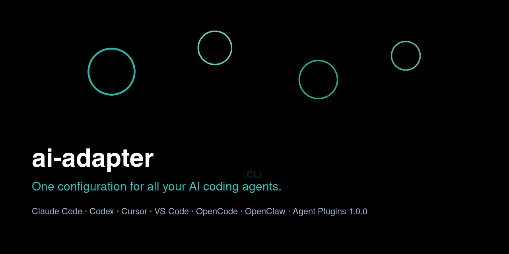

# ai-adapter


**One configuration for all your AI coding agents.**

[](https://github.com/smapira/ai-adapter-01/actions/workflows/ci.yml)[](https://www.python.org/)

Manage and sync your AI agent configuration across Claude Code, Codex, Cursor, VS Code, OpenCode and more.

```bash
# Get started in 3 commands
pip install ai-adapter
ai-adapter init
ai-adapter start <your-config-repo-url>
```

```text
            ┌─────────────┐
            │  ai-adapter  │
            └──────┬──────┘
       ┌───────────┼───────────┐
       ▼           ▼           ▼
 ┌─────────┐ ┌─────────┐ ┌─────────┐
 │ Claude  │ │  Codex  │ │  Cursor │
 │  Code   │ │   CLI   │ │  rules  │
 └─────────┘ └─────────┘ └─────────┘
     ▼           ▼           ▼
 ┌─────────┐ ┌─────────┐ ┌─────────┐
 │ VS Code │ │ OpenCode│ │ OpenClaw│
 └─────────┘ └─────────┘ └─────────┘
```

> ## Agent Plugins 1.0.0 Compliant
>
> `ai-adapter` natively supports the **Agent Plugins 1.0.0** open standard
> ([agent-plugins.org](https://agent-plugins.org/)) — the vendor-neutral packaging
> format for skills + MCP servers backed by AWS, Microsoft, OpenAI, Anysphere, and Vercel.
> Build, validate, and distribute portable plugin packages with:
>
> ```bash
> ai-adapter plugin build my-plugin
> ai-adapter plugin validate ./my-plugin
> ```
>
> Your skills and MCP servers become portable across Copilot, Cursor, Codex,
> VS Code, AWS Kiro and more — with a single `plugin.json` manifest.

A CLI tool for managing AI agent instruction files (`.github/instructions` etc.) and scripts in groups. Easily share and migrate settings across environments.

---

## Features

- **Agent Plugins 1.0.0 Compliant**: Native support for the industry-standard plugin format — `plugin build` scaffolds a portable package, `plugin validate` checks `plugin.json` / `mcp.json` / `skills/` against the spec (name rules, server types, `${PLUGIN_ROOT}` placeholders, reserved env keys, SKILL.md frontmatter)
- **Centralized Management**: All data is consolidated under `~/.ai-adapter/`. Centrally manage settings across projects
- **Environment Switching**: Switch agent settings and scripts per environment (e.g., work, home)
- **GitHub Sync**: Use `ai-adapter sync` to sync `~/.ai-adapter/` with a GitHub remote. Easy team sharing and PC migration
- **Agent Binding**: Bind agent names to environments for automatic resolution based on context
- **Skill Management**: Manage and deploy skills in SKILL.md format (`.github/skills/`)
- **Command Management**: Manage and deploy VS Code custom command definitions (`.github/commands/`)
- **Prompt Management**: Manage and deploy prompt templates for AI agents (`.github/prompts/`)
- **MCP Server Management**: Centrally manage MCP server settings and output in each tool format
- **OpenCode Integration**: Generate `opencode.json`/`opencode.jsonc` (JSONC with comments) with MCP, skills (`.claude/skills`, `.agents/skills` compat paths supported), prompts, and agents; symlink `.opencode` → `.github`
- **OpenClaw Integration**: Export MCP servers and skills to OpenClaw format (`--format openclaw`)
- **Cursor Integration**: Export MCP servers and skills to Cursor format (`--format cursor` → `.cursor/mcp.json` + `.cursor/rules/*.mdc`); legacy `.cursorrules` (`--format cursorrules`) and plugin packages (`--format cursor-plugin` → `~/.cursor/plugins/local/`) for migration (design 07)
- **Codex CLI Integration**: Generate `AGENTS.md` for OpenAI Codex CLI (`ai-adapter codex install`)
- **Root-Level Agent Management**: Manage `AGENTS.md`, `CLAUDE.md`, etc. as first-class artifacts, deployable to project root
- **Runtime Monitor (Runtime Plane)**: `ai-adapter monitor` discovers AI agent sessions running in Orca / VS Code / Zed and reports what they are doing — read-only observability (never sends input, never changes IDE settings, never stops processes)

---

## Supported Tools

| Tool | Status | Integration |
|------|--------|-------------|
| **GitHub Copilot** | ✅ Partial | `.github/` (agents, skills, commands, prompts, bins) + `.mcp.json` |
| **Claude Code** | ✅ Partial | `.github/` fallback + `--format claude` → `.claude/` native paths (agents, skills, user MCP) |
| **OpenCode** | ✅ Full | `ai-adapter opencode install` → `opencode.json`/`opencode.jsonc` (+ `.opencode` symlink); `sub-agent get --format opencode --scope user` → `~/.config/opencode/agents/` |
| **Codex CLI** | ✅ Full | `ai-adapter codex install` → `AGENTS.md`; `sub-agent get --format codex` → `.codex/agents/*.toml` (custom agents) |
| **Cursor** | ✅ Skills + MCP | `--format cursor` → `.cursor/rules/*.mdc` + `.cursor/mcp.json`; `--format cursorrules` (legacy) → `.cursorrules`; `--format cursor-plugin` → `~/.cursor/plugins/local/<project>/` |
| **OpenClaw** | ✅ Partial | `--format openclaw` → `~/.openclaw/` (MCP + skills) |
| **Orca** | ✅ Partial | Shared `~/.claude/skills/` + `.mcp.json` via OpenClaw-style export |
| **Gemini CLI** | ✅ Full | `ai-adapter gemini install` → `.gemini/` (settings.json, commands/*.toml, GEMINI.md); `--with-extension` → `~/.gemini/extensions/<name>/`; `command/prompt get --format gemini` → TOML; `sub-agent get --format gemini` → `.gemini/agents/*.md` |
| **Zed** | ✅ Full | `ai-adapter zed install` → `AGENTS.md` + `.agents/skills/` (Zed discovery path); `zed validate` checks settings.json/SKILL.md; `skill get-all --format zed` |
| **Agent Plugins 1.0.0** | ✅ Full | `ai-adapter plugin build/validate` (portable packages) |

Not supported yet:

| Tool | Status | Notes |
|------|--------|-------|
| **Continue** | ❌ Planned | `.continuerc.json` rules export is a future task |

Per-file-type details: [LLM Tool Specification Comparison](documents/wiki/LLM-Tool-Comparison.md).

---

## Installation

### Prerequisites

- Python 3.10+
- [uv](https://docs.astral.sh/uv/) (package management)

```bash
# Also installable via pip
pip install ai-adapter

# Or use uv
uv pip install ai-adapter
```

### Upgrade

```bash
# Upgrade via pip
pip install --upgrade ai-adapter

# Upgrade via uv
uv pip install --upgrade ai-adapter

# Upgrade to the latest development version
cd ai-adapter && git pull && uv sync && uv pip install -e .
```

### Development Version

```bash
git clone <repository-url>
cd ai-adapter
uv sync
uv pip install -e .
```

### Verification

```bash
ai-adapter --help
ai-adapter --version
```

---

## Quick Start

```bash
# 1. Initialize
ai-adapter start https://github.com/YOUR-REPO/YOUR-CONFIG.git

# 2. Add an agent file (for .github/agents/, e.g. individual .agent.md files)
ai-adapter sub-agent add ~/my-agents/reviewer.md

# 2b. Add a root-level agent file (for project-root AGENTS.md/CLAUDE.md)
ai-adapter agent add ~/my-agents/AGENTS.md

# 3. Add an environment
ai-adapter env add myhome

# 4. Add a script
ai-adapter bin add --env myhome ~/scripts/deploy.sh

# 5. Add a skill (optionally with --env)
ai-adapter skill add ~/my-skills/database-schema
ai-adapter skill add --env myhome ~/my-skills/database-schema

# 6. Add an MCP server
ai-adapter mcp add github --command npx --args @modelcontextprotocol/server-github

# 7. Deploy to a project
cd your-project
ai-adapter sub-agent get reviewer      # → .github/agents/reviewer.md
ai-adapter agent get AGENTS            # → ./AGENTS.md (project root)
ai-adapter bin get --env myhome deploy   # → .github/bin/deploy.sh
ai-adapter skill get database-schema  # → .github/skills/database-schema/
ai-adapter skill get-all --env myhome # → deploy only myhome skills
ai-adapter mcp get                     # → .mcp.json

# 8. Deploy to OpenClaw (optional, requires OpenClaw installed)
ai-adapter mcp get --format openclaw          # → ~/.openclaw/openclaw.json
ai-adapter skill get-all --format openclaw    # → ~/.openclaw/skills/

# 8b. Deploy to Claude Code native paths (optional)
ai-adapter skill get-all --format claude      # → .claude/skills/
ai-adapter sub-agent get reviewer --format claude  # → .claude/agents/reviewer.md
ai-adapter mcp get --format claude --scope user    # → ~/.claude.json (merged)

# 9. Sync with GitHub (share settings)
ai-adapter sync
```

---

## Command Reference

Full command usage — every subcommand, option, and per-platform deployment
format — is documented in the **[Command Reference wiki](documents/wiki/Commands.md)**.

Quick index:

| Category | Commands |
|----------|----------|
| **Setup & sync** | `init` · `start` · `sync` · `status` · `uninstall` |
| **Bulk import/export** | `add-all-rec` · `get-all-rec` |
| **Agents** | `sub-agent` (`.agent.md`) · `agent` (root `AGENTS.md`/`CLAUDE.md`) |
| **Content** | `skill` · `command` · `prompt` · `bin` · `mcp` |
| **Environments** | `env` (add/remove/link-agent, per-env scoping) |
| **Platform integration** | `opencode` · `codex` · `vscode` · `gemini` · `zed` · Claude Code · OpenClaw · Cursor |
| **Diagnostics** | `doctor` · `scan` · `monitor` · `optimize` · `version` |
| **Packaging** | `plugin` (Agent Plugins 1.0.0) · `setup` · `pack` · `skill install` |

```bash
# Register from a synced repo, then deploy to a project
ai-adapter add-all-rec
cd your-project && ai-adapter get-all-rec

# Per-entity examples
ai-adapter sub-agent get reviewer --fix          # → .github/agents/ (array tools)
ai-adapter sub-agent convert ~/x.agent.md --format codex   # → codex--x.toml
ai-adapter skill get database-schema --format claude
ai-adapter mcp get --format openclaw

# Diagnostics
ai-adapter doctor          # health + tools-format mismatches
ai-adapter monitor         # live agent sessions (Orca / VS Code / Zed)
```

> **`tools` format differs per platform.** VS Code & Gemini expect an **array**,
> OpenCode an **object**, Claude Code a **comma-separated string**. A mismatch is
> silent — the agent never loads. `--fix` normalises `.github/agents/` to array
> format; `sub-agent convert` produces any platform's shape; `doctor` detects
> deployed mismatches.

---

## Data Storage

All data is stored under `~/.ai-adapter/`.  
Project-level files are deployed to `.github/` (may change in future versions).

```
~/.ai-adapter/
├── config.json                 # Main configuration file
├── agents/                     # AI agent .agent.md files (managed by sub-agent)
│   ├── reviewer.md
│   ├── implementer.md
│   └── researcher.md
├── bin/                        # Script files
│   ├── deploy-prod.sh
│   └── deploy-staging.sh
├── skills/                     # Skill directories
│   ├── database-schema/
│   │   ├── SKILL.md
│   │   └── examples/
│   └── security-review/
│       └── SKILL.md
├── instructions/               # Root-level agent files (managed by agent)
│   ├── AGENTS.md
│   └── CLAUDE.md
└── mcp/                        # MCP server settings
    └── servers.json
```

This directory can be turned into a Git repository and synced across multiple PCs via GitHub.

### Environment Resolution Priority

When `--env` is omitted in `add` / `add-rec` commands (for `bin`, `skill`, `command`, `prompt`):

1. If the `--agent` option is explicitly specified, the bound environment of that agent is used
2. If the relevant agent exists in `agent_bindings`, its bound environment is used
3. If neither applies, `default_env` (default: `"default"`) is used

For `list`, `get`, `get-all`, `remove`, `remove-all` commands, `--env` acts as a filter.
Items with no env set (universal) are always included regardless of the filter.

---

## Configuration File

All settings are stored in `~/.ai-adapter/config.json`.

```json
{
  "version": 1,
  "default_env": "default",
  "agent_bindings": [
    { "agent": "reviewer", "env": "myhome" },
    { "agent": "implementer", "env": "office" }
  ],
  "agents": [
    { "name": "reviewer", "description": "Agent for code review" },
    { "name": "implementer", "description": "Agent for implementation" }
  ],
  "envs": [
    { "name": "default", "description": "Default environment" },
    { "name": "myhome", "description": "Home development environment" },
    { "name": "office", "description": "Office development environment" }
  ],
  "bins": [
    { "name": "deploy-prod.sh", "env": "myhome", "description": "Production deployment" },
    { "name": "format-all.sh", "env": "default", "description": "Code formatting" }
  ],
  "skills": [
    {
      "name": "database-schema",
      "description": "Database schema design and review knowledge",
      "path": "skills/database-schema",
      "tags": ["database", "prisma", "schema"],
      "agent": "reviewer",
      "env": "production"
    }
  ],
  "commands": [
    { "name": "deploy", "content": "#!/bin/bash\necho deploy", "env": "production" }
  ],
  "prompts": [
    { "name": "code-review", "content": "Review checklist...", "env": "staging" }
  ],
  "mcp_servers": [
    {
      "name": "github",
      "command": "npx",
      "args": ["@modelcontextprotocol/server-github"],
      "env_keys": ["GITHUB_TOKEN"],
      "enabled": true,
      "tools": ["vscode", "claude", "cursor"]
    }
  ]
}
```

---

## Use Cases

### Sharing LLM configuration files between office and home

```bash
# Office PC
ai-adapter init
ai-adapter agent add ~/company-agent.md
ai-adapter env add office
ai-adapter sync

# Home PC
git clone <your-ai-adapter-repo> ~/.ai-adapter
ai-adapter agent get company-agent   # → .github/agents/company-agent.md
```

### Migrating to a new PC

```bash
# New PC
git clone <your-ai-adapter-repo> ~/.ai-adapter
ai-adapter bin list                  # Check registered scripts
ai-adapter bin get deploy-prod       # Deploy the required scripts
```

### Different agent settings per project

```bash
ai-adapter env add project-a
ai-adapter env add project-b
ai-adapter agent add reviewer-a.md
ai-adapter env link-agent reviewer-a project-a

# Running in project-a automatically uses the project-a environment
cd /path/to/project-a
ai-adapter bin add deploy.sh
```

---

## Development

### Development Environment

```bash
uv sync
uv pip install -e .
```

### Running Tests

Tests must run inside the sandbox directory (`.testbox/`): the suite operates
on `Path.cwd() / ".github"` (backup → delete → restore), and running it from the
repo root can permanently destroy `.github/workflows` if interrupted.

```bash
# All tests (sandboxed — safe)
bash scripts/run_tests.sh

# Verbose output
bash scripts/run_tests.sh -v

# Single test file / module
bash scripts/run_tests.sh tests/test_env.py
bash scripts/run_tests.sh tests/test_env.py -k add   # keyword filter

# Pytest (optional; cwd is isolated per-test by tests/conftest.py)
uv run pytest
```

`run_tests.sh` uses pytest (not `unittest discover`) intentionally:
`tests/conftest.py`, which chdirs every test into a fresh temp directory, is a
pytest plugin. Under a bare unittest run, `add_to_gitignore()` walks up from
`.testbox/` to the real repo's `.git` and appends test artefacts to the real
`.gitignore`, polluting the repository.

### Linter and Type Checking

```bash
uv run ruff check .
uv run ruff format .
uv run mypy src/
```

---

## Project Structure

```
ai-adapter/
├── pyproject.toml              # Project settings, dependencies, entry points
├── README.md                   # This file
├── LICENSE                     # MIT License
├── .gitignore                  # Git ignore settings
├── src/
│   └── ai_adapter/
│       ├── __init__.py         # Version information
│       ├── __main__.py         # python -m ai_adapter support
│       ├── cli.py              # CLI entry point (registers all subcommands)
│       ├── config.py           # Read/write ~/.ai-adapter/config.json
│       ├── models.py           # Data models (dataclass)
│       ├── diff.py             # Sync diff comparison
│       ├── git.py              # Git operation wrapper
│       ├── sync.py             # sync command (GitHub sync)
│       ├── agent_format.py     # Agent file YAML format utilities
│       ├── agent_plugins.py    # Agent Plugins 1.0.0 validation (plugin.json / mcp.json / skills)
│       ├── commands/           # Subcommand implementations
│       │   ├── agent.py        # agent subcommand
│       │   ├── bin.py          # bin subcommand
│       │   ├── command.py      # command subcommand
│       │   ├── env.py          # env subcommand
│       │   ├── get_all_rec.py  # get-all-rec subcommand (deploy everything + summary)
│       │   ├── instruction.py  # instruction subcommand (root AGENTS.md etc.)
│       │   ├── mcp.py          # mcp subcommand
│       │   ├── plugin.py       # plugin subcommand (Agent Plugins build/validate)
│       │   ├── prompt.py       # prompt subcommand
│       │   └── skill.py        # skill subcommand
│       └── providers/          # External tool integrations
│           ├── opencode.py     # OpenCode integration (install/alias/uninstall)
│           ├── openclaw.py     # OpenClaw integration (MCP + skills export)
│           ├── cursor.py       # Cursor integration (MCP + skills export to .cursor/)
│           └── codex.py        # Codex CLI integration (AGENTS.md generation)
├── tests/
│   ├── __init__.py
│   ├── test_config.py
│   ├── test_agent.py
│   ├── test_env.py
│   ├── test_bin.py
│   ├── test_skill.py
│   ├── test_mcp.py
│   ├── test_sync.py
│   ├── test_git.py
│   ├── test_cli.py
│   ├── test_cursor.py          # Cursor integration tests
│   └── test_instruction.py
└── examples/
    └── sample-config.json      # Sample configuration file
```

---

## Tech Stack

| Category | Technology |
|------|---------|
| Language | Python 3.10+ |
| CLI Framework | Click |
| Configuration File | JSON (standard library) |
| Testing | pytest — sandboxed via `scripts/run_tests.sh` into `.testbox/`, with per-test cwd isolation (`tests/conftest.py`) |
| Package Management | uv |

---

## License

MIT License
